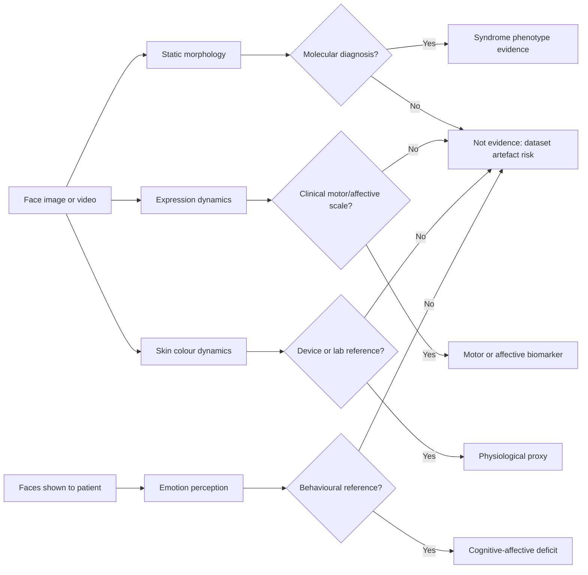

# Clinical face-derived biomarkers: cross-condition evidence review

**Review type:** rapid scoping review with a reproducible search log, not a
systematic review or meta-analysis.

**Search date:** 2026-10-13. **Coverage:** facial photographs and facial video
used as a clinical measurement across genetic syndromes, neurodevelopmental
conditions, movement and motor-neuron disease, affective and psychotic
disorders, and video-derived physiology; the validity of single-image 3D face
reconstruction as a morphometric substrate; the retraction record of
face-based diagnostic claims; and the permission regime that governs facial
patient data.

**Relation to the other reviews in this repository.** This document is
deliberately *not* a second FaceAge review.
[`literature_review.md`](literature_review.md) owns facial age estimation,
apparent age, and the FaceAge prognostic line;
[`../brainage/literature_review.md`](../brainage/literature_review.md) owns
brain-age models. This review owns the *surrounding clinical field*: what else
a face is claimed to measure, how strong that evidence is, and which failure
modes have already produced retractions. Dataset routes for paired twin
face-brain data are in
[`../twin_head_imaging_datasets.md`](../twin_head_imaging_datasets.md); this
review adds only the computer-vision twin benchmarks that registry does not
cover. The regulatory and partnership consequences of the claims discussed here
are in
[translation_and_regulatory_landscape.md](translation_and_regulatory_landscape.md).

## Research question

When a face is used as clinical data, what is actually being measured, and
which claims survive scrutiny?

The field routinely conflates five distinct targets that have different
substrates, different reference standards, and very different evidence
quality:

1. **Facial morphology as a genetic marker.** Static craniofacial shape as a
   phenotypic signature of a monogenic or chromosomal disorder. Reference
   standard: molecular diagnosis.
2. **Emotion perception by the patient.** How accurately the patient reads
   faces shown to them. The measurement is behavioural; the patient's own face
   is not the data.
3. **Expression production by the patient.** Amplitude, speed, symmetry and
   temporal stability of the patient's own facial movement. Reference
   standard: a clinical motor or affective scale.
4. **Physiology inferred from facial video.** Pulse, perfusion, haemoglobin
   proxies recovered from skin colour dynamics. Reference standard: a medical
   device or laboratory value.
5. **Facial age.** Covered in [`literature_review.md`](literature_review.md)
   and referenced here only where a result constrains this review.

A model that classifies a syndrome is not measuring aging. A patient who reads
faces poorly is not thereby expressing poorly. A plausible 3D mesh is not a
metric reconstruction. These are separate claims requiring separate evidence.

## Search and selection

Searches were run against PubMed (primary studies and retraction notices),
Consensus semantic search over Semantic Scholar/OpenAlex/PubMed, publisher
retraction notices, arXiv abstract pages, and official benchmark and dataset
pages. Queries, inclusion rules and verification notes are in
[clinical_face_evidence_search_log.md](clinical_face_evidence_search_log.md).

Every numerical claim in this document was read from an abstract, retraction
notice, or benchmark page retrieved by tool in the same session. Items that
could not be verified are listed explicitly in
[Unverified and excluded claims](#unverified-and-excluded-claims) rather than
paraphrased. No claim here is written from recall.

This rapid review did not perform duplicate screening, full-database export,
formal meta-analysis, risk-of-bias scoring, or author contact.

## Evidence map

| Evidence track | Representative evidence | What it supports | Main limitation |
|---|---|---|---|
| Syndrome phenotyping | DeepGestalt: >17,000 images, >200 syndromes, 91% top-10 on 502 images [1]; GestaltMatcher: 17,560 patients, 1,115 disorders, matches disorders absent from training [2] | Facial gestalt is a usable phenotypic prior for rare-disease diagnosis | Trained on curated clinical photo platforms; demographic and expression confounds (below) |
| Negative-control validation | Pantel: top-10 sensitivity 91%, but syndrome/non-syndrome separation only AUROC 0.72, and 17 syndromes appear in top-30 for >50% of non-dysmorphic faces [4] | Sensitivity alone overstates clinical utility | Convenience sample; matched-control design only |
| Tool benchmarking | Reiter: 4,796 images, 486 syndromes, 323 controls; top-30 sensitivity DeepGestalt 88% vs GestaltMatcher 76%; separation AUROC 0.73 / 0.55 / 0.86 (D-Score) [5] | The three tools solve different tasks and are not interchangeable | Retrospective image sources; D-Score rises with age and is higher in males |
| Demographic transportability | Porras: 2,800 photos, 128 conditions; accuracy 88% overall but 90% White / 91% Hispanic vs 84% African / 82% Asian [6] | Face-phenotyping accuracy is population-dependent | Race/ethnicity labels coarse; source databases heterogeneous |
| Expression confound | Patel: non-smiling Williams and Angelman images receive lower correct-syndrome probability; not so for 22q11.2 and Noonan [7] | Models partly learn expression, not morphology | GAN-edited stimuli; expert survey and eye-tracking endpoints |
| Emotion perception (ASD) | Yeung: subsets of 148 studies, impairment in all basic emotions, non-selective across modality [10]; Griffin: 112 studies, 5,390 participants, identity recognition g = -0.86 [11] | Robust, large, replicated behavioural deficit | Behavioural construct; does not license inference from the patient's own face |
| Expression production (PD) | Abrami: AUROC 0.71 vs 0.75 for neurologists; on/off state 63% vs 46% for raters [15]; Irani: 101 PD / 94 HC, concordant facial-limb lateralisation (P = 0.002), up to 90.1% CV accuracy [16] | Facial motor phenotype is measurable and has construct validity | Small cohorts; within-cohort cross-validation |
| Expression production (stroke, ALS) | Oliveira: Toronto NeuroFace, 14 post-stroke / 11 controls, 82% accuracy on two expressions [18]; Migliorelli: landmark NME 1.79, 11 bulbar-onset ALS [19] | Open dataset and runnable pipeline exist | Pilot-scale; single dataset |
| Affective disorders | Yamasue: 366 analysed, SCID-5-RV reference, accuracy 78% / AUC 0.76 multimodal [23]; Trinhammer: only AU4 survives interpretable analysis, AUROC 69% [24] | Modest, honestly reported discrimination | Single-shot designs; higher published figures not externally validated |
| Treatment monitoring | Atzil-Slonim: 283 sessions, 58 clients; emotional flexibility tracks depression at treatment and session level [25] | Monitoring is better supported than diagnosis | Observational; one therapy modality |
| Video physiology | Frey: 25 included studies, only 2 contactless facial video, no established validation protocol [29]; Shirbani: max 80% success, face ROIs only, none for hand [30] | Signal exists but is weak and unstandardised | Tiny samples; reference-measurement heterogeneity |
| Colour-based screening | Collings: conjunctival erythema index sensitivity 93% training vs 57% internal validation [31]; Wemyss: identical redness achievable at Hb 2.35 and 15 g/dL [32] | Colour alone is an unreliable substrate | Monte-Carlo simulation for the negative result |
| Single-image 3D validity | NoW metric protocol: MICA mean 1.51 mm, DECA 1.80 mm, mean FLAME mesh 1.92 mm (1.53 mm scale-corrected) [36] | Recoverable identity shape is a few tenths of a millimetre above the mean face | Cross-paper comparison; see caveat in Section 6 |
| Reconstruction fairness | Shilova: systematic age-related bias across 3DMM bases and fitting algorithms [38] | Preprocessing error is age-coupled | Preprint; gender/ethnicity findings preliminary |
| Retraction record | 11 retracted face-based ASD papers (Section 7); notices cite unvalidated diagnosis, absent guardian consent, no ethical oversight | A documented, repeated failure mode with named causes | Notice text retrieved for two of eleven |

## Findings

### 1. Genetic syndromes are the only mature application, and maturity is narrower than headline numbers suggest

DeepGestalt established the paradigm: a CNN trained on over 17,000 images
spanning more than 200 syndromes, curated through a community phenotyping
platform, reaching 91% top-10 accuracy on 502 images in a task designed to
mirror a real clinical setting, and outperforming clinicians in three
experiments including separation of Noonan genetic subtypes [1]. GestaltMatcher
changed the formulation from supervised classification to a metric Clinical
Face Phenotype Space over 17,560 patients and 1,115 disorders, where distance
encodes syndromic similarity; critically, patients can be matched to others
with the same molecular diagnosis **even when the disorder was absent from
training**, which is what makes the approach usable for ultra-rare disease [2].

Three independent results bound the claim:

- **Negative controls matter and were initially missing.** Pantel et al.
  confirmed high sensitivity (top-10: 295/323, 91%) but showed that on
  non-dysmorphic control faces the syndrome suggestions are *not* randomly
  distributed: 17 syndromes appeared in the top 30 for more than half of
  non-dysmorphic images. Separating syndromic from control images by top score
  gives only AUROC 0.72, improving to 0.89 with a linear SVM over the full
  result vector [4].
- **The tools are not interchangeable.** Across 4,796 images of 486 syndromes
  plus 323 controls, DeepGestalt suggested 340 distinct syndromes and
  GestaltMatcher 1,128. Top-30 sensitivity was 88% (SD 18) versus 76% (SD 26).
  For separating patients from controls DeepGestalt reached AUROC 0.73,
  GestaltMatcher could not separate them at all (0.55), and the
  purpose-trained D-Score reached 0.86 — but D-Score levels increase with age
  and are higher in males, while ethnicity showed no apparent influence [5].
- **Accuracy is population-dependent.** The largest point-of-care evaluation
  (2,800 photos; 1,400 children with 128 conditions plus 1,400 matched
  controls) reported 88% accuracy overall (90% sensitivity, 86% specificity)
  but 90% in White and 91% in Hispanic children against 84% in African and 82%
  in Asian children [6]. This study is also the only one in this review that
  documents image provenance by source.

Independent replication outside these groups exists but is single-centre: a
VGG-16 transfer model on 456 frontal photographs (228 children with genetic
syndromes, 228 healthy) from one Guangdong hospital reached accuracy
0.8860 ± 0.0211 and AUC 0.9443 ± 0.0276, reported as significantly higher than
five physicians [9]. Five-fold cross-validation, no external cohort.

**Confound worth carrying into our own design.** Williams and Angelman
syndromes are stereotypically associated with a smiling demeanour. Images of
these syndromes *without* a smile received significantly lower predicted
probability for the correct label, whereas 22q11.2 deletion and Noonan — not
associated with a smiling expression — showed no such effect. The authors
confirmed this by GAN-editing expressions (HyperStyle over StyleGAN2, edited
following the InterfaceGAN concept) while preserving phenotype, then measured
expert performance by survey and eye-tracking [7]. The model is partly reading
expression, not morphology.

**Current frontier is evidential, not diagnostic.** The most interesting 2026
development reframes next-generation phenotyping as *quantified evidence inside
a formal framework*: GestaltMatcher plus PEDIA (HPO terms with simulated exome
data), with Bayesian likelihood modelling used to set Gestalt-score thresholds
for ACMG PP4 evidence levels (supporting, moderate, strong, very strong). In
the reported case three of four facial images met the PP4 moderate threshold
and one met supporting [12]. This is a far more defensible role than "diagnosis
from a photograph", and it is the closest analogue to what a FaceAge-derived
measure could legitimately claim.

### 2. Autism: the consensus is strong but it is about perception, not appearance

This distinction is routinely lost in applied work and is the direct cause of
the retraction cluster in Section 7.

The behavioural evidence is large and consistent. Random-effects meta-analyses
over subsets of 148 studies show significant impairment in recognising **all**
basic facial emotions in ASD; the impairment is greater than in other clinical
conditions; and it is similarly present for emotional and non-emotional facial
attributes and for emotion recognition in non-face modalities. Emotion
complexity and holistic processing moderate the effect; motion, social
relevance and stimulus salience do not. The authors' conclusion is that the
deficit is **non-selective** — relatively specific to ASD, but not specific to
emotion and not specific to the face modality [10]. Forty years of face-identity
research (112 studies, 5,390 participants, 172 effect sizes) gives recognition
Hedge's g = -0.86 and discrimination g = -0.82, stable across age, sex, IQ and
paradigm [11]. Neuroimaging converges: an ALE meta-analysis of 22 fMRI studies
(539 ASD, 502 TD) finds both groups engaging right fusiform gyrus and left
fusiform face area, with TD additionally recruiting left amygdala, and ASD
showing increased right cerebellum lobule VI and left secondary visual cortex
[13].

Training improves the trained task and little else: RCT meta-analysis over 595
individuals with ASD shows robust improvement in emotion recognition, some
evidence of generalisation, no maintained effect and **no demonstrated
improvement in social skills** [14]. A transdiagnostic extension over 29 studies
reports SMD 0.681 (95% CI 0.513-0.848) in autistic and 0.773 (0.001-1.535) in
non-autistic clinical samples, with long-term maintenance rarely tested [8].

**There is no verified evidence in this review for a static facial dysmorphism
of autism.** The claim exists in the literature only in the retracted papers of
Section 7, where the data provenance is the explanation.

### 3. Neurology has the best construct validity

Parkinson hypomimia is the strongest case for a face-derived motor biomarker
because an external reference exists (MDS-UPDRS-III item 3.2) and because a
falsifiable anatomical prediction can be tested.

The careful result is modest and should be quoted rather than the inflated
alternatives: a CNN trained on images from videos of 107 self-identified people
with PD plus 1,595 control videos reached test AUROC 0.71 on 54 subjects for
detecting hypomimia, against 0.75 for trained neurologists using the
UPDRS-III facial expression score. The model's advantage was not diagnosis but
**state tracking**: on/off medication classification 63% (22/35) versus 46%
(16/35) for clinical raters [15].

The methodologically strongest recent work tests laterality. Across two
independent cohorts (101 PD, 94 healthy controls), facial asymmetry was greater
in PD, most prominently in eyebrow and periocular regions during happy
expressions (P = 0.01); and among participants with asymmetric limb
parkinsonism, facial mobility was significantly reduced on the hemiface
corresponding to the more affected limb (P = 0.002) — concordant facial-limb
lateralisation. Dynamic asymmetry features reached up to 90.1% cross-validated
accuracy within cohort [16]. The laterality concordance is the part that
constitutes construct validity, not the accuracy figure. Instrumented
alternatives (vertical electro-oculogram plus facial surface EMG in 24 PD / 24
controls, using spontaneous blink rate, blink amplitude, and frontal and
peribuccal muscle activity) provide a non-camera comparator [17].

For stroke and ALS there is an open dataset, the **Toronto NeuroFace Dataset**
of RGB video from standard orofacial examinations, which makes this the most
reproducible subfield. Action units computed by XGBoost trained on healthy
controls and classified by regression per expression separated post-stroke from
control at 82% accuracy on "Kiss" and "Spread" with best sensitivity 91%, with
mouth musculature most informative — on 14 post-stroke and 11 control subjects
[18]. The same dataset supports a facial-landmark Mask R-CNN in a
store-and-forward telemonitoring architecture for dysarthria, with normalised
mean error 1.79 for landmark localisation, additionally tested on 11 subjects
with bulbar-onset ALS [19].

### 4. Psychiatry: separate what the patient perceives from what the patient expresses

**Perception.** The meta-analytic picture is solid and transdiagnostic. In
schizophrenia the deficit is present in unaffected **first-degree relatives**
(34 studies reviewed, 23 meta-analysed): SMD 0.38 (95% CI 0.26-0.51,
p ≤ 0.001), driven by negative-valence expressions (SMD 0.19, 0.06-0.32,
p = 0.004) with no deficit for neutral or positive valence [20] — evidence that
it precedes onset rather than following it. Across diagnoses, bipolar disorder
patients are **more** accurate than schizophrenia patients (SMD 0.27,
p = 0.006; anger 0.46, fear 0.38, sadness 0.33) and **less** accurate than MDD
patients (SMD -0.24, p = 0.014; sadness -0.31, p = 0.009), with no difference
from youth with ADHD, over 33 studies comparing 1,506 BD patients with 1,973
clinical controls [21].

**Production.** Here the published accuracy range is wide and the top of it is
not externally validated. The highest claim is Emoface: facial digital
biomarkers from videos of 353 participants under emotional stimuli, then
clinical application in 347 patients, with accuracy 95.29% for BD and 87.05%
for MDD [22]. Single-centre, no external validation. The most trustworthy
figure comes from an independent nationwide Japanese study: 379 participants
recruited, 366 analysed (120 bipolar I, 93 bipolar II, 122 MDD, 74 persistent
depressive disorder), diagnoses by SCID-5-RV, AI over facial expressions, eye
gaze and voice prosody, four-fold three-times-repeated cross-validation —
**overall accuracy 78%, AUC 0.76**. The contributing features were temporal
*instabilities* in neutral expression, eye gaze, sad expression and speech RMS
amplitude [23]. When the same question is asked with an inherently interpretable
model, far less survives: over 32 participants viewing emotional film clips,
Fisher's linear discriminant analysis isolates brow lowering (AU4) at AUROC up
to 69%, and the authors argue explicitly against deploying uninterpretable
pipelines whose "promising performance estimates" carry limited clinical value
[24].

For depression the best-supported use is **longitudinal monitoring, not
diagnosis**. Automated FER over 283 sessions of manualised psychodynamic therapy
in 58 clients shows higher emotional flexibility associated with lower
depressive symptoms at both treatment and session level [25]. In severe
treatment-resistant depression under deep brain stimulation, unsupervised
variability features from muted video (multiscale entropy, a dynamic latent
variable model) in an elastic-net ordinal regression discriminate three levels
of recovery severity [26]. At the subclinical end, OpenFace 2.0 shows elevated
AU01, AU05, AU20 and AU25/26/28 in subthreshold depression with five AUs
correlating with BDI-II after FDR correction, while human observers' first
impressions are **not** biased — the signal is machine-detectable and
human-invisible [27]. The field-level picture, from 544 records screened and 264
included, is heterogeneity in datasets, features and metrics, and a stated need
for transparent models [28].

Note for our own pipeline: one 2026 group building a 3D reconstruction for
exactly this purpose reports that standard monocular reconstruction loses
affect-relevant cues, which is why they built a vision-language-guided
fine-grained framework (AsmV2L) to preserve them, reaching 88.9% subject-level
BD/MDD discrimination from valence-arousal dynamics over reconstructed 3D faces
[39]. That is independent confirmation of the concern in Section 6.

### 5. Video-derived physiology is the least mature and the most overclaimed

A systematic review of blood-pressure measurement using only a smartphone
identified 333 articles and included 25 from a decade: **23 require direct
sensor contact and only 2 are contactless facial video**. Sample sizes range
from 3 to 3,000 with only 8 studies at n ≥ 85; 10 include hypertensive
subjects; and the authors state plainly that methodologies vary considerably,
there is no consistency in data collection or reference measurement, and **no
established protocol exists for validating blood-pressure technologies using
only a smartphone** [29]. A mechanistic study makes the difficulty concrete: in
10 healthy volunteers with BP varied by isometric handgrip and leg ischaemia,
four vPPG methods (GREEN, ICA, CHROM, POS) across 14 facial and 5 palmar ROIs
and all pulse-transit-time permutations achieved a maximum success rate of 80%,
only for specific facial ROIs, and **for no permutation using the hand** [30].

Anaemia illustrates the colour-substrate problem end to end. Conjunctival
erythema index from a compact camera and an iPhone 5S with an in-frame
calibration card gave sensitivity 93% on training but **57% on internal
validation** (specificity 78% and 83%, Hb < 110 g/L), with palpebral
outperforming forniceal conjunctiva [31]. Monte-Carlo tissue-optics simulation
then showed why: redness depends on vessel density, depth and diameter as well
as haemoglobin, and within plausible physiological ranges the same redness is
achievable at Hb 2.35 g/dL and 15 g/dL, so simple redness measurement may be
unsuitable for detecting anaemia [32]. The constructive response is to abandon
colour for spatial and textural features: radiomics over 12,441 palpebral and
12,375 bulbar conjunctiva photographs from three smartphone models in 565
Rwandan children aged 5-15 found spatial and textural features significantly
associated with anaemia status [33].

On skin-tone bias the evidence is better than often assumed but thin: an
industrial benchmark of ~330 videos from 90 patients, Fitzpatrick grouped
1-2 / 3-4 / 5-6, reports heart-rate MAE 3 bpm and HRV errors of 10 ms (IBI),
14 ms (SDNN) and 22 ms (RMSSD) with no significant performance decrease and no
error trend for any skin-tone group [34]. One method, one vendor, one
laboratory — not a closed question. Finally, a three-month deployment with
knowledge workers lost **42% of data** after adjustments, citing video
resolution, quality consistency and dataset bias [35] — a realistic prior for
any uncontrolled facial-video collection.

### 6. Single-image 3D reconstruction: the mean face is a strong baseline

This section exists because it directly constrains
[`../../scripts/photo_mri_avatar/EVALUATION.md`](../../scripts/photo_mri_avatar/EVALUATION.md).

The NoW benchmark comprises 2,054 images of 100 test subjects (20 validation,
80 test) across expression, pose and occlusion; predictions are rigidly aligned
to the ground-truth mesh by 3D landmarks and per-vertex errors aggregated. The
**original protocol is not metric** — Procrustes alignment includes scale — so
millimetre figures are comparable only within one protocol.

| Setting | median (mm) | mean (mm) |
|---|---|---|
| Average FLAME mesh, no reconstruction | — | **1.92**, falling to **1.53** with metric shape correction |
| DECA, metric protocol | 1.35 | 1.80 |
| MICA, metric protocol | 1.25 | 1.51 |
| DECA, non-metric protocol | 1.09 | 1.38 |
| MICA, non-metric protocol | 0.90 | 1.11 |
| TokenFace / Pixel3DMM / FlowFace, non-metric | 0.76 / 0.87 / 0.87 | 0.95 / 1.07 / 1.07 |

Read the top three rows together. Under the metric protocol MICA sits at
roughly the level of the scale-corrected mean face and DECA is worse than it
[36]. **Caveat:** these figures are assembled across papers with differing
subsets and reporting conventions, and the mean-face comparison is an in-paper
comparison whose table layout the retrieving source flagged as ambiguous. The
order of magnitude is nonetheless the operative fact: the subject-specific
identity shape recoverable from a single photograph lives in a band of a few
tenths of a millimetre above "predict the average face".

Two further results undermine the assumption that reconstruction yields a
*uniform* substrate across subjects:

- **Alignment choice dominates the score.** The REALY benchmark exists because
  aligning two shapes with different reference points can largely affect
  evaluation results. It uses 100 scans from LYHM, consistently rescaled,
  globally aligned and wrapped into topology-consistent meshes, with
  region-wise alignment and bidirectional non-rigid ICP across four masks
  (nose, mouth, cheek, forehead). Methods fail in different regions: DECA
  performs best on nose and GANFit better on cheek; MICA fails in the mouth
  region and HRN on the forehead [37]. Reconstruction error is therefore
  spatially structured and method-specific, not isotropic noise.
- **The error is age-coupled.** Evaluating several 3DMM bases and fitting
  algorithms with curvature-based error maps from the Laplace-Beltrami
  operator — a metric whose authors report significantly better correlation
  with human perception than Euclidean alternatives — uncovers **systematic
  age-related biases**, with preliminary evidence of gender and ethnicity
  biases [38].

**Consequence for this project.** Our target variable is age. If stage-one
reconstruction error depends on age, then age is encoded in the "geometry"
handed to stage two by preprocessing rather than by biology, and conventional
metrics cannot distinguish the two. This is the same logical failure as the
dataset-artefact learning in Section 7, with an age-biased morphable-model
prior in place of acquisition conditions.

Three protocol additions follow, in priority order:

1. **Mean-mesh null.** Run the existing
   `scripts/photo_mri_avatar/compare_photo_mesh_to_mri.py` with the average
   BFM/FLAME mesh substituted for the reconstruction, using the same forced LAS
   anterior cap (`front_axis=1`, `front_sign=+1`) and the same ICP. Our recorded
   pilot median of approximately 2 mm for both MediaPipe and 3DDFA_V2 is within
   the band where the mean face scores on NoW; if the null reproduces it, the
   metric has no discriminative power and cannot rank baselines however many are
   added.
2. **Age-coupling gate.** Regress the ICP residual on chronological age. A
   non-zero slope is a confound that must be reported before any FaceAge-gap to
   BrainAge-gap comparison.
3. **Identity-permutation null.** Align subject A's photo mesh to subject B's
   MRI surface. Not available at n = 1; mandatory once a cohort exists.

For calibration of what *measured* 3D achieves, see
[Section 8](#8-what-measured-3d-actually-costs).

### 7. The retraction record: eleven papers, one dataset, one root cause

PubMed filtered to `autism AND facial AND images AND deep learning` with
publication type `Retracted Publication` returns **eleven** records.

| Publ. | Article | Journal | Dataset per the authors' own abstract | DOI |
|---|---|---|---|---|
| 2022 | Deep Learning for Autism Diagnosis and Facial Analysis in Children (94.6%) | Front Comput Neurosci | "3,014 images, evenly split" | [10.3389/fncom.2021.789998](https://doi.org/10.3389/fncom.2021.789998) |
| 2022 | Facial Features Detection System To Identify Children With ASD (MobileNet 95%) | Comput Math Methods Med | "publicly available dataset on **Kaggle** … 3,014 facial images, 1,507 autistic / 1,507 non-autistic" | [10.1155/2022/3941049](https://doi.org/10.1155/2022/3941049) |
| 2022 | Classification and Detection of ASD Based on Deep Learning Algorithms (Xception 91%) | Comput Intell Neurosci | "collected from the **Kaggle** platform … 2,940 face images" | [10.1155/2022/8709145](https://doi.org/10.1155/2022/8709145) |
| 2022 | Empirical Study of ASD Diagnosis Using Facial Images by Improved Transfer Learning (Xception 95%) | Bioengineering | "The human face can be used as a biomarker" | [10.3390/bioengineering9110710](https://doi.org/10.3390/bioengineering9110710) |
| 2023 | Control learning rate for autism facial detection via deep transfer learning | Signal Image Video Process | — | [10.1007/s11760-023-02598-9](https://doi.org/10.1007/s11760-023-02598-9) |
| 2023 | A face image classification method of autistic children based on two-phase transfer learning (AUC 96.32%) | Front Psychol | mobile-phone facial images | [10.3389/fpsyg.2023.1226470](https://doi.org/10.3389/fpsyg.2023.1226470) |
| 2024 | Ambiguous facial expression detection for Autism Screening using enhanced YOLOv7-tiny | Sci Rep | — | [10.1038/s41598-024-77549-6](https://doi.org/10.1038/s41598-024-77549-6) |
| 2025 | A deep learning-based ensemble for ASD diagnosis using facial images | PLOS ONE | — | [10.1371/journal.pone.0321697](https://doi.org/10.1371/journal.pone.0321697) |
| 2025 | A multi-filter deep transfer learning framework for image-based ASD detection (ViTSwin) | Sci Rep | "well-established benchmark facial dataset in the literature" | [10.1038/s41598-025-97708-7](https://doi.org/10.1038/s41598-025-97708-7) |
| 2025 | Automated identification of ASD from facial images using explainable deep learning (VGG19 98.2%) | Sci Rep | — | [10.1038/s41598-025-11847-5](https://doi.org/10.1038/s41598-025-11847-5) |
| 2025 | Hybrid deep learning model for ASD diagnosis (MobileNetV2+GRU 95.5%) | Sci Rep | "facial image dataset obtained from the **Kaggle** repository" | [10.1038/s41598-025-28819-4](https://doi.org/10.1038/s41598-025-28819-4) |
| 2025 | Leveraging hybrid ConvNextBase + LightGBM for early ASD detection via eye-gaze | MethodsX | "publicly available **Kaggle** dataset" | [10.1016/j.mex.2025.103166](https://doi.org/10.1016/j.mex.2025.103166) |

A thirteenth retraction sits in the Parkinson literature: *Facial expressions
can detect Parkinson's disease* (npj Digital Medicine 2021, SVM over AU6/AU12/
AU4 variability, 95.6% accuracy) is retracted, notice February 2023 [40]. The
95.6% figure has propagated into secondary reviews and inflates perceived
maturity of the field.

**Stated reasons, where the notice text was retrieved.**

*PLOS ONE,* "Can artificial intelligence and face recognition using deep
learning detect emotions in children with autism?" (retracted article
PLoS One 20(12):e0338701; notice PLoS One 20(12):e0340338, PubMed date
2025-12-26) [41]: concerns raised with the datasets used; the authors used
Kaggle datasets; the reported autism diagnosis "does not appear to have been
validated"; "it is not clear whether the legal guardians of the children
included in the dataset gave consent" for public distribution or academic use;
editors cite concerns pertaining to the ethics and the validity of the dataset
underlying the study. **All authors did not agree with the retraction**, stating
they used the datasets under common AI and computer-science practice.

*Scientific Reports* 2024, YOLOv7-tiny [42]: "Concerns were raised regarding
the use of images of minors from a non-curated dataset"; images "collected from
the internet without any documented clinical history or confirmation of an
actual ASD diagnosis"; "there is no documented ethical oversight, or consent of
the children included in the dataset"; the Editor and Publisher no longer have
confidence in the reliability of the article. **The authors agree with this
retraction.**

**Root cause.** The accuracy figures cluster at 91-98.2% and the dataset sizes
cluster at 2,940-3,014 images in a 1:1 autistic/non-autistic split. This is one
web-scraped Kaggle collection passed through different backbones. Because the
collection was assembled by web scraping, the two classes almost certainly
differ in acquisition conditions — posed clinical or charity photographs versus
stock imagery — so the models learn background, lighting and crop. That
explains why these setups report 95%+ while rigorous morphometry on
molecularly confirmed syndromes reports balanced accuracy 73% and mean
sensitivity 49% [3].

**The practice is not confined to retracted work.** A 2025 paper in *JMIR
Formative Research* on gelotophobia detection in ASD reports "2932 facial
images collected from platforms such as Kaggle and ASD-related websites,
including 1466 images of children with ASD" and is **not retracted** [43].
Filtering by retraction status is therefore insufficient; provenance must be
filtered directly.

### 8. What measured 3D actually costs

Expectations for stage-one geometry should be calibrated against studies where
geometry is *measured* rather than inferred.

- **Consumer scanners against a professional reference.** Against Artec Eva in
  28 participants, consumer structured-light systems achieved global surface
  RMSE 0.72 ± 0.24 mm (Revopoint MIRACO) and 0.57 ± 0.17 mm (Creality
  CR-Scan 01), with over 90% of surface points within 1 mm (91 ± 8% and
  93 ± 7%). **Smartphone photogrammetry** (Kiri Engine, 22 datasets meeting
  quality criteria) achieved 1.41 ± 0.58 mm with only 68 ± 16% of points within
  1 mm; both structured-light systems significantly outperformed it
  (p < 0.001), while not differing from each other (p = 0.42) [44].
- **Smartphone 3D in a clinical population.** In 17 cleft lip and palate
  patients with 18 landmarks and 32 inter-landmark measurements, smartphone-
  generated images against direct anthropometry and 3dMD showed only 16% and
  59% of measures within ≤3 mm or ≤5° respectively, mean absolute difference
  1.31 ± 0.34 mm linear and 4.11 ± 0.76° angular. The authors conclude limited
  clinical applicability for the whole oronasal region [45]. The application
  used is named *Bellus3D FaceApp* — worth noting because it is easily confused
  with the unrelated Wireless Lab photo editor.
- **3D Gaussian splatting.** In 58 adults, 3DGS showed narrower limits of
  agreement than 2D photogrammetry and generally higher correlations with
  direct anthropometry, but LoA reached approximately 10-18 mm for some linear
  and exceeded 20° for some angular outcomes, indicating limited
  interchangeability for individual-level clinical decisions [46].

Even measured smartphone 3D is marginal for individual-level claims. Geometry
inferred from a single legacy photograph is weaker still.

### 9. Twin benchmarks for embedding validity

[`../twin_head_imaging_datasets.md`](../twin_head_imaging_datasets.md) already
registers the medical twin cohorts (TwinsUK, LSADT, RATSS, QTIM, TwinsMX,
Forsyth, EMIF-AD PreclinAD, Monash). This section adds only the category that
registry does not cover — computer-vision twin benchmarks — plus the published
heritability values needed to interpret an embedding.

**Identity-discrimination benchmarks** (Notre Dame CVRL, per-dataset licence
signed by an institutionally authorised signatory, submitted from an
institutional address to `cvrl@nd.edu`, delivered via Globus, with online
redistribution outside the research community forbidden):

| Dataset | Content | Note |
|---|---|---|
| ND-TWINS-2009-2010 | 435 subjects, 24,050 colour photographs, Nikon D90, 2009 and 2010 | Yaw -90° to +90° in 45° steps; indoor tent and outdoor; MZ, DZ **and ordinary siblings**; some pairs photographed both years, enabling time-lapse tests; ~250 GB |
| ND Twins Face Recognition Test Set | 6,538 images as 3,000 same-person and 3,000 different-person pairs, the latter being MZ pairs | The ready-made benchmark form |
| 3D-TEC | 107 pairs (214 subjects), 428 3D scans, neutral and smiling per person | ~1.5 GB; the relevant one for 3D morphometry |
| Celeb Twins Test Set (CTTS) | 80 sets of celebrity twins, web-scraped, LFW/CALFW/CPLFW/CFP-FP/AgeDB-30 format | The only twins test set with metadata for distinguishing skin marks and possible mirror asymmetry; current deep CNN matchers exceed 76% accuracy and **do not use** skin marks or asymmetry [47] |

Note that CTTS is itself web-scraped; it is appropriate as a technical
benchmark of adult public figures, not as clinical data, and should carry the
corresponding `dataset_ethics_status` value (Section 10).

**Heritability values for interpreting an embedding.** From 1,380 female
TwinsUK twins with 3dMD stereophotogrammetry, 37 manual landmarks and
Procrustes registration: heritability reached significance for 13 unscaled and
17 scaled principal components with h² from 38.8% to 78.5% and 30.5% to 84.8%
respectively, and 1,222 of 1,275 linear distances showed evidence of genetic
control. Genetic factors explain **more than 70%** of variation in facial size,
nose width, prominence and height, lip prominence and inter-ocular distance;
common environment contributed to one PC per group and 53 distances (4.3%);
environmental contribution was greatest for mandibular ramus height and
horizontal facial asymmetry [48]. An automated successor over 952 TwinsUK twins
uses GESSA (Geodesic Ensemble Surface Sampling Algorithm) to place thousands of
landmarks with automatic point-wise correspondence and produce curvature
heritability maps, motivated explicitly by earlier estimates being low and
poorly replicable [49]. A small precursor (21 pairs: 10 MZ, 11 same-sex DZ, 13
landmarks) found moderate-to-high heritability for three PCs relating to
orbital and nasal breadth, upper-lip height and projection, and nasion position
[50].

**Critical constraint.** One description of the TwinsUK imaging collection gives
1,521 twins aged 16.5-87.3 years of whom **98.6% are female**. Sex differences
in facial aging cannot be assessed on this resource.

**Design implication.** Raw FaceAge will correlate near-perfectly within MZ
pairs by construction, because MZ twins share both chronological age and
genome; that number is uninformative. The informative quantity is the
within-pair correlation of the **residual** (FaceAge minus chronological age):
r_MZ(gap) ≈ h² + c², and 1 - r_MZ(gap) bounds unique environment plus
measurement noise. A high r_MZ(FaceAge) with a low r_MZ(gap) indicates the
embedding is reading the calendar rather than biology. The within-pair
difference in MZ twins also provides an upper bound on embedding measurement
noise without a separate test-retest acquisition. The discordant-MZ extension —
within-pair Δ(face-age gap) against within-pair Δ(brain-age gap) — controls the
genome exactly rather than statistically. No dataset in this review or in our
registry currently holds both facial images and MRI for twins, which is what
the outreach campaign in `papers/outreach/` is for.

### 10. Permissions, re-identification, and a required dataset field

Regulatory structure for facial patient data (IRB, HIPAA authorisation or
waiver, GDPR Article 9 special-category basis, local UAE/DHA requirements,
publication consent for recognisable images, dataset licence) is conventional.
Three empirical results sharpen it.

**De-identification does not reach anonymity.** The best quantification comes
from facial CT: 3,206 scans (308,982 images) from 3,091 patients, with a
YOLOv8-based model selectively removing facial soft tissue while preserving
facial bone (detection mAP@0.5 = 0.858). Deep-learning re-identification
accuracy fell from 85% to 64%; in a blind human assessment correct
identification fell from 84% to 55%, with no substantial difference between
general participants (84→55%) and plastic surgeons (83→54%) [51]. More than half
of identifiability survives aggressive de-identification, so "anonymised"
facial data remain personal data under GDPR, and anonymisation is not a route
around consent.

**Consent wording should name the analysis, not the data type.** A survey of
4,048 US adults found general comfort with biometrics, with trust in social
actors to use biometrics responsibly appearing **context-specific rather than
dependent on biometric type**, and no obvious sociodemographic patterning [52].

**Jurisdiction of origin governs permissible use** more tightly than a dataset
licence does; an analysis in the *Journal of Medical Ethics* notes the absence,
at publication, of a facial-recognition law protecting residents' facial data
in China [53].

**Required registry field.** Section 7 shows that filtering by retraction status
is insufficient. Add `dataset_ethics_status` to
[`../../data/research_dataset_registry.csv`](../../data/research_dataset_registry.csv)
with decidable values:

| Value | Criterion | Permitted use |
|---|---|---|
| `consented_clinical` | IRB plus documented consent covering ML use, plus confirmed diagnosis | Yes |
| `hospital_retrospective_irb` | IRB or waiver, diagnosis from the medical record, controlled access | Yes, no redistribution |
| `public_licensed_research_only` | Licence explicitly permits research ML; adult subjects; no medical labels | Yes, cite the licence |
| `public_unclear_consent` | Public, but consent provenance undocumented | Technical benchmarking only, no clinical conclusions |
| `web_scraped_minors_medical_labels` | Children's faces with an unverified medical label | **Do not use** — the 2022-2025 retraction pattern |

The final value should block publication automatically rather than by author
discretion.

## What this review does not establish

- It does not establish that any facial measurement diagnoses any condition.
  The best-supported uses across every domain reviewed are **prognostic or
  monitoring**, not diagnostic: facial age predicts survival, computer-vision
  hypomimia tracks on/off state better than it detects disease, FER flexibility
  tracks treatment response.
- It does not establish that single-image 3D reconstruction is a valid
  morphometric substrate. Section 6 argues the opposite pending our own null
  test.
- It does not rank the syndrome-phenotyping tools for our use, since none was
  evaluated on MRI-derived surfaces.
- It does not cover facial dermatology, ophthalmology, oncology pain
  assessment, or endocrine facial phenotypes, which were out of scope.
- It does not constitute a provenance audit of any dataset we hold.

## Unverified and excluded claims

The following circulated in the working notes that seeded this review and
**could not be verified** with any tool in this session. They are recorded so
they are not reintroduced.

| Claim | Status |
|---|---|
| Review reporting ~76% diagnostic and ~63% monitoring accuracy for Parkinson facial analysis | Not located; likely inherited from the retracted [40] |
| "ALS: pursed-lip smile, 20 AUs, 91% accuracy by logistic regression" | Not verified. Nearest verified result is **post-stroke**, not ALS: 82% accuracy, 91% *sensitivity* [18] |
| "Loth et al. 2022, meta-analysis of 72 studies on ASD emotion recognition" | Not verified. Largest verifiable meta-analysis draws on subsets of **148** studies [10] |
| "Children/adolescents with ASD: SMD = -1.29 versus TD and -0.89 versus other neurodevelopmental conditions" | Not verified. Verifiable effects are face identity g = -0.86 [11] and training efficacy SMD 0.681/0.773 [8] |
| "Anaemia from 15-second video, AUC 0.84, accuracy 0.82 in an ED study" | Not verified. See [31] and the negative optics result [32] |
| "ESC 2026 algorithm extracting blood pressure and diabetes signals from one facial video" | Not verified. Contradicted in direction by [29] |
| "Stroke triage AUC 0.82 in ~6 minutes from multimodal video and audio" | Not verified |
| Emoface published in *Nature Mental Health* with 95.38% / 85.61% accuracy | Incorrect. Journal is ***npj* Mental Health Research**; figures are **95.29% / 87.05%** [22] |
| DeepGestalt trained on ">30,000 patient images" | Incorrect. The paper states **over 17,000** images across more than 200 syndromes [1] |
| "A Comparison of Facial Emotion Processing in Neurological and Psychiatric Conditions" in *Frontiers in Human Neuroscience* | Incorrect journal. It is **Frontiers in Psychology** 3:98, and it is a **re-analysis of four of the authors' own prior studies** by Cohen's d, not a primary comparative study. Its findings: dopaminergic medication does not modify the deficit in schizophrenia or PD (ON vs OFF), while effect size increases across aMCI → AD → FTD, implicating frontotemporal neurodegeneration rather than the dopaminergic system [54] |
| Author disagreement attributed to the *Scientific Reports* 2025 retraction | Misattributed. Documented disagreement belongs to the **PLOS ONE** notice [41]; the *Scientific Reports* 2024 authors **agreed** [42]. For [10.1038/s41598-025-11847-5](https://doi.org/10.1038/s41598-025-11847-5) the retraction is confirmed but the notice text could not be retrieved, so reasons and author position remain unverified |

## References

Records marked **(PubMed)** were retrieved from PubMed; DOI links are given as
required by that source's terms. Records marked **(Consensus)** were retrieved
through Consensus semantic search over Semantic Scholar/OpenAlex/PubMed.

1. Gurovich Y, et al. Identifying facial phenotypes of genetic disorders using deep learning. *Nature Medicine*, 2019. (Consensus)
2. Hsieh T-C, et al. GestaltMatcher facilitates rare disease matching using facial phenotype descriptors. *Nature Genetics* 54(3):349-357, 2022. (PubMed) [DOI](https://doi.org/10.1038/s41588-021-01010-x)
3. Hallgrímsson B, et al. Automated syndrome diagnosis by three-dimensional facial imaging. *Genetics in Medicine*, 2020. (Consensus)
4. Pantel JT, et al. Efficiency of computer-aided facial phenotyping (DeepGestalt) in individuals with and without a genetic syndrome. *Journal of Medical Internet Research*, 2020. (Consensus)
5. Reiter AMV, et al. Validation of 3 computer-aided facial phenotyping tools (DeepGestalt, GestaltMatcher, and D-Score). *Journal of Medical Internet Research*, 2024. (Consensus)
6. Porras AR, et al. Development and evaluation of a machine learning-based point-of-care screening tool for genetic syndromes in children. *The Lancet Digital Health*, 2021. (Consensus)
7. Patel T, et al. Approximating facial expression effects on diagnostic accuracy via generative AI in medical genetics. *Bioinformatics*, 2024. (Consensus)
8. Revilla R, et al. Facial emotion recognition trainings for children and adolescents: a transdiagnostic systematic review and meta-analysis. *Clinical Psychology & Psychotherapy* 32(4):e70116, 2025. (PubMed) [DOI](https://doi.org/10.1002/cpp.70116)
9. Hong D, et al. Genetic syndromes screening by facial recognition technology: VGG-16 screening model construction and evaluation. *Orphanet Journal of Rare Diseases* 16(1):344, 2021. (PubMed) [DOI](https://doi.org/10.1186/s13023-021-01979-y)
10. Yeung MK. A systematic review and meta-analysis of facial emotion recognition in autism spectrum disorder. *Neuroscience & Biobehavioral Reviews* 133:104518, 2021. (PubMed) [DOI](https://doi.org/10.1016/j.neubiorev.2021.104518)
11. Griffin JW, Bauer R, Scherf KS. A quantitative meta-analysis of face recognition deficits in autism: 40 years of research. *Psychological Bulletin* 147(3):268-292, 2020. (PubMed) [DOI](https://doi.org/10.1037/bul0000310)
12. Hsieh T-C, et al. Leveraging next-generation phenotyping in dysmorphology to support variant interpretation in Mowat-Wilson syndrome. *Neurology Genetics* 12(4):e200384, 2026. (PubMed) [DOI](https://doi.org/10.1212/NXG.0000000000200384)
13. Behrouzi A, Valles-Capetillo E, Kana RK. An ALE meta-analysis of the neural evidence of facial emotion processing in autism. *World Journal of Biological Psychiatry* 26(2):74-91, 2025. (PubMed) [DOI](https://doi.org/10.1080/15622975.2024.2446823)
14. Zhang Q, et al. Facial emotion training as an intervention in autism spectrum disorder: a meta-analysis of randomized controlled trials. *Autism Research* 14(10):2169-2182, 2021. (PubMed) [DOI](https://doi.org/10.1002/aur.2565)
15. Abrami A, et al. Automated computer vision assessment of hypomimia in Parkinson disease: proof-of-principle pilot study. *Journal of Medical Internet Research* 23(2):e21037, 2021. (PubMed) [DOI](https://doi.org/10.2196/21037)
16. Irani A, et al. Quantitative assessment of facial expression asymmetry in Parkinson's disease. *Journal of Movement Disorders*, 2026. (PubMed) [DOI](https://doi.org/10.14802/jmd.26080)
17. Maremmani C, et al. Objective assessment of blinking and facial expressions in Parkinson's disease using a vertical electro-oculogram and facial surface electromyography. *Physiological Measurement* 40(6):065005, 2019. (PubMed) [DOI](https://doi.org/10.1088/1361-6579/ab1c05)
18. Oliveira GC, et al. Facial expressions to identify post-stroke: a pilot study. *Computer Methods and Programs in Biomedicine* 250:108195, 2024. (PubMed) [DOI](https://doi.org/10.1016/j.cmpb.2024.108195)
19. Migliorelli L, et al. A store-and-forward cloud-based telemonitoring system for automatic assessing dysarthria evolution in neurological diseases from video-recording analysis. *Computers in Biology and Medicine* 163:107194, 2023. (PubMed) [DOI](https://doi.org/10.1016/j.compbiomed.2023.107194)
20. Martin D, et al. Systematic review and meta-analysis of the relationship between genetic risk for schizophrenia and facial emotion recognition. *Schizophrenia Research* 218:7-13, 2020. (PubMed) [DOI](https://doi.org/10.1016/j.schres.2019.12.031)
21. De Prisco M, et al. Differences in facial emotion recognition between bipolar disorder and other clinical populations: a systematic review and meta-analysis. *Progress in Neuro-Psychopharmacology & Biological Psychiatry* 127:110847, 2023. (PubMed) [DOI](https://doi.org/10.1016/j.pnpbp.2023.110847)
22. Yu J, et al. Emoface: AI-assisted diagnostic model for differentiating major depressive disorder and bipolar disorder via facial biomarkers. *npj Mental Health Research*, 2025. (Consensus)
23. Yamasue H, et al. Differentiation between bipolar versus unipolar depression by AI-based multimodal behavioral analysis. *Psychiatry and Clinical Neurosciences*, 2026. (Consensus)
24. Trinhammer ML, et al. Don't predict if you cannot interpret: investigating the clinical viability of facial movements for machine-learning assisted diagnostics of bipolar disorder. *Nordic Journal of Psychiatry*, 2026. (Consensus)
25. Atzil-Slonim D, et al. Facing change: using automated facial expression analysis to examine emotional flexibility in the treatment of depression. *Administration and Policy in Mental Health* 51(4):501-508, 2023. (PubMed) [DOI](https://doi.org/10.1007/s10488-023-01310-w)
26. Harati S, et al. Classifying depression severity in recovery from major depressive disorder via dynamic facial features. *IEEE Journal of Biomedical and Health Informatics* 24(3):815-824, 2019. (PubMed) [DOI](https://doi.org/10.1109/JBHI.2019.2930604)
27. Sugimori E, Yamaguchi M. Subthreshold depression is associated with altered facial expression and impression formation via subjective ratings and action unit analysis. *Scientific Reports* 15(1):30761, 2025. (PubMed) [DOI](https://doi.org/10.1038/s41598-025-15874-0)
28. Mao K, Wu Y, Chen J. A systematic review on automated clinical depression diagnosis. *npj Mental Health Research* 2(1):20, 2023. (PubMed) [DOI](https://doi.org/10.1038/s44184-023-00040-z)
29. Frey L, Menon C, Elgendi M. Blood pressure measurement using only a smartphone. *npj Digital Medicine* 5(1):86, 2022. (PubMed) [DOI](https://doi.org/10.1038/s41746-022-00629-2)
30. Shirbani F, et al. Contactless video-based photoplethysmography technique comparison investigating pulse transit time estimation of arterial blood pressure. *IEEE EMBC* 2021:5650-5653. (PubMed) [DOI](https://doi.org/10.1109/EMBC46164.2021.9629489)
31. Collings S, et al. Non-invasive detection of anaemia using digital photographs of the conjunctiva. *PLOS ONE* 11(4):e0153286, 2016. (PubMed) [DOI](https://doi.org/10.1371/journal.pone.0153286)
32. Wemyss TA, Rajendram R, Leung TS. Pitfalls in using pallor of the eye to detect anaemia with digital cameras. *IEEE EMBC* 2025:1-6. (PubMed) [DOI](https://doi.org/10.1109/EMBC58623.2025.11253991)
33. Hong SG, et al. Radiomic identification of anemia features in monochromatic conjunctiva photographs in school-age children. *Biophotonics Discovery* 2(2):022303, 2025. (PubMed) [DOI](https://doi.org/10.1117/1.bios.2.2.022303)
34. Talukdar D, De Deus LF, Sehgal N. The evaluation of remote monitoring technology across participants with different skin tones. *Cureus* 15(9):e45075, 2023. (PubMed) [DOI](https://doi.org/10.7759/cureus.45075)
35. Ferreira S, et al. Overcoming challenges in video-based health monitoring: real-world implementation, ethics, and data considerations. *Sensors* 25(5):1357, 2025. (PubMed) [DOI](https://doi.org/10.3390/s25051357)
36. Zielonka W, Bolkart T, Thies J. Towards metrical reconstruction of human faces (MICA). *ECCV*, 2022. [ECVA PDF](https://www.ecva.net/papers/eccv_2022/papers_ECCV/papers/136730249.pdf). Supporting metric and non-metric figures cross-read from [arXiv:2304.12483](https://arxiv.org/pdf/2304.12483), [arXiv:2403.05218](https://arxiv.org/pdf/2403.05218) and [arXiv:2608.09238](https://arxiv.org/pdf/2608.09238)
37. Chai Z, Zhang T, et al. REALY: rethinking the evaluation of 3D face reconstruction. [arXiv:2203.09729](https://arxiv.org/abs/2203.09729)
38. Shilova V, Malherbe E, Palma G, Bokaris P-A, Risser L, Loubes J-M. Discovering geometric biases in 3D face reconstruction: a curvature-aware spectral framework for fairness evaluation. [arXiv:2607.07486](https://arxiv.org/abs/2607.07486), 2026 preprint
39. Du T, et al. Three-dimensional face reconstruction for emotional dynamics: a novel approach to distinguishing bipolar disorder from major depressive disorder. *Journal of Zhejiang University-SCIENCE B*, 2026. (Consensus)
40. **RETRACTED.** Ali MR, et al. Facial expressions can detect Parkinson's disease: preliminary evidence from videos collected online. *npj Digital Medicine* 4(1):129, 2021. (PubMed) [DOI](https://doi.org/10.1038/s41746-021-00502-8). Retraction Note: *npj Digital Medicine* 6(1):20, 2023. [DOI](https://doi.org/10.1038/s41746-023-00761-7)
41. **RETRACTED.** Güngör İ, Sarman A, Tuncay S. Can artificial intelligence and face recognition using deep learning detect emotions in children with autism? *PLOS ONE* 20(12):e0338701, 2025. (PubMed) [DOI](https://doi.org/10.1371/journal.pone.0338701). Retraction: *PLOS ONE* 20(12):e0340338. [DOI](https://doi.org/10.1371/journal.pone.0340338)
42. **RETRACTED.** Kumar A, Kumar A, Jayakody DNK. Ambiguous facial expression detection for autism screening using enhanced YOLOv7-tiny model. *Scientific Reports* 14(1):28501, 2024. (PubMed) [DOI](https://doi.org/10.1038/s41598-024-77549-6)
43. Eldawansy M, El Bakry H, Shohieb SM. Data mining-based model for computer-aided diagnosis of autism and gelotophobia: mixed methods deep learning approach. *JMIR Formative Research* 9:e72115, 2025. (PubMed) [DOI](https://doi.org/10.2196/72115) — **not retracted**, cited here as a provenance warning
44. Ondrejová B, et al. Validation of consumer-grade 3D scanners for clinical facial reconstruction: comparison with a professional structured-light reference system. *Bioengineering* 13(8):941, 2026. (PubMed) [DOI](https://doi.org/10.3390/bioengineering13080941)
45. Singh P, et al. Smartphone-generated 3D facial images: reliable for routine assessment of the oronasal region of patients with cleft or mere convenience? A validation study. *BMC Oral Health* 24(1):1517, 2024. (PubMed) [DOI](https://doi.org/10.1186/s12903-024-05280-9)
46. Genç C, et al. 3D Gaussian splatting vs. 2D photogrammetry and direct anthropometry for facial measurements. *Orthodontics & Craniofacial Research* 29(4):688-697, 2026. (PubMed) [DOI](https://doi.org/10.1111/ocr.70116)
47. Zang M, Wu H, Sharma M, Bowyer KW. Revisiting face recognition for monozygotic twins: the Celeb Twins Test Set. [arXiv:2609.01141](https://arxiv.org/abs/2609.01141), 2026 preprint. Notre Dame dataset terms from the [CVRL datasets page](https://cvrl.nd.edu/projects/data/)
48. Djordjevic J, Zhurov AI, Richmond S. Genetic and environmental contributions to facial morphological variation: a 3D population-based twin study. *PLOS ONE* 11(9):e0162250, 2016. (PubMed) [DOI](https://doi.org/10.1371/journal.pone.0162250)
49. Tsagkrasoulis D, Hysi P, Spector T, Montana G. Heritability maps of human face morphology through large-scale automated three-dimensional phenotyping. [arXiv:1608.08199](https://arxiv.org/abs/1608.08199), 2016
50. Weinberg SM, Parsons TE, Marazita ML, Maher BS. Heritability of face shape in twins: a preliminary study using 3D stereophotogrammetry and geometric morphometrics. *Dentistry 3000* 1(1), 2013. (PubMed) [DOI](https://doi.org/10.5195/d3000.2013.14)
51. Kang SU, et al. De-identification strategy and re-identification risks for facial computed tomography images via deep learning. *Journal of Imaging Informatics in Medicine*, 2026. (PubMed) [DOI](https://doi.org/10.1007/s10278-026-01858-7)
52. Katsanis SH, et al. U.S. adult perspectives on facial images, DNA, and other biometrics. *IEEE Transactions on Technology and Society* 3(1):9-15, 2021. (PubMed) [DOI](https://doi.org/10.1109/tts.2021.3120317)
53. Su Z, et al. Facial recognition law in China. *Journal of Medical Ethics* 48(12):1058-1059, 2022. (PubMed) [DOI](https://doi.org/10.1136/medethics-2022-108130)
54. Bediou B, et al. A comparison of facial emotion processing in neurological and psychiatric conditions. *Frontiers in Psychology* 3:98, 2012. (PubMed) [DOI](https://doi.org/10.3389/fpsyg.2012.00098)
55. Lee G, et al. FaceAge as a biomarker for prognosis and treatment stratification in large-scale oncology cohort. *Journal of the National Cancer Institute*, 2025. (Consensus) — cross-reference for [`literature_review.md`](literature_review.md)
56. Lee G, et al. Multimodal assessment of biological age following radiation therapy among patients with early-stage NSCLC. *JAMA Network Open*, 2026. (Consensus) — face age aHR/decade 1.39 while chronological age was not significant; lung age correlation r = 0.07
57. Haugg F, et al. Face aging rate quantifies change in biological age to predict cancer outcomes. *Nature Communications*, 2026. (Consensus) — serial-photograph rate adds information beyond single-timepoint FaceAge
58. Nusinovici S, et al. Retinal photograph-based deep learning predicts biological age, and stratifies morbidity and mortality risk. *Age and Ageing*, 2022. (Consensus) — third-modality precedent for triangulation
59. Abbas Q, et al. FaceAge+: training-free synthetic augmentation for deep learning-based biological age estimation from facial images. *Scientific Reports*, 2026. (Consensus) — age-conditioned StyleGAN2 W-space synthesis to correct age imbalance; MAE 3.27 y UTKFace, 2.20 y IMDb-Wiki
60. da Silva CNF, et al. Computer aided diagnosis of neurodevelopmental disorders and genetic syndromes based on facial images — a systematic literature review. *Heliyon*, 2023. (Consensus)
