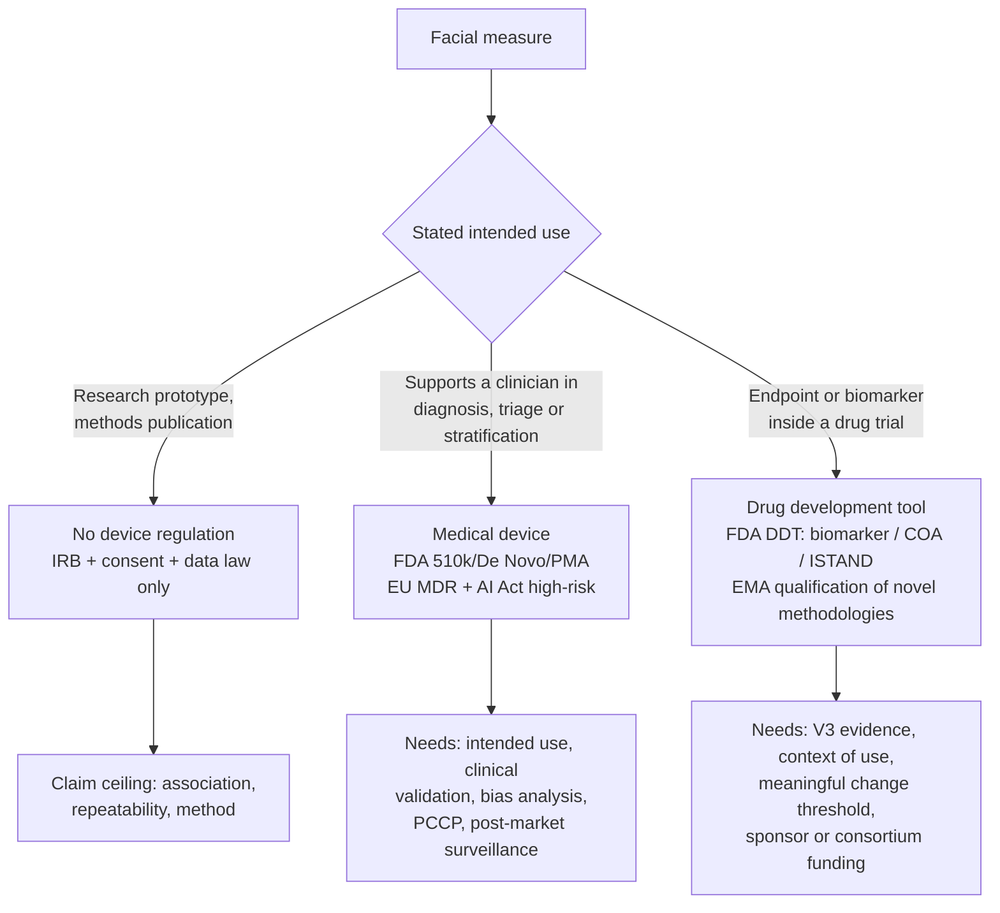

# Translation, regulation and partnership landscape for facial digital measures

**Review type:** rapid scoping review of the regulatory and commercial route
for a facial-video or facial-image digital measure, with an embedded search and
verification record. Not legal or regulatory advice.

**Search date:** 2026-10-13. **Coverage:** what determines whether a facial
measure is regulated as a medical device; the two distinct qualification
pathways (device versus drug-development tool); the single existing regulatory
precedent for a wearable-derived digital endpoint; the evidence framework
regulators actually read; what is currently sold commercially; and how
industry-academia agreements allocate data ownership, publication rights and
money.

**Relation to the other documents here.**
[clinical_face_evidence_review.md](clinical_face_evidence_review.md) covers what
a face can be shown to measure clinically.
[literature_review.md](literature_review.md) and
[metrics_protocol.md](metrics_protocol.md) cover facial age and our metric
contracts. This document covers what happens if any of it leaves the
repository: which claim triggers which regime, what the claim costs in
evidence, and under what contract structure the work would be funded.

## Research question

Not "can this be commercialised" but: **which claim are we making, and what does
that claim cost in evidence?**

The answer is almost entirely determined by one choice, and it is a wording
choice before it is a technical one.



The determining principle across both jurisdictions is **intended use, not
technology**. A model that outputs a number is unregulated; the same model
described as "helps the clinician detect Parkinson's" is a medical device. This
is why the wording of our own abstracts matters as much as our metrics.

## 1. The device route

### United States

AI-enabled software with a medical purpose is a medical device, reaching market
through 510(k), De Novo or PMA. The piece specific to AI is the
**Predetermined Change Control Plan (PCCP)**: FDA published final guidance
*Marketing Submission Recommendations for a Predetermined Change Control Plan
for Artificial Intelligence-Enabled Device Software Functions* on
**3 December 2024** [1]. A PCCP must describe the planned modifications, the
methodology to develop, validate and implement them, and an assessment of their
impact; it covers modifications that would otherwise require a new marketing
submission. Hardware modifications are out of scope, and anything outside an
authorised PCCP still needs a new submission.

Two details matter for us. First, the final version added recommendations to
consider the **intended-use population and environment, including ethnicity,
gender and disease severity** — which is exactly the stratification our
[clinical_face_evidence_review.md](clinical_face_evidence_review.md) shows to be
the weak point of face models (accuracy 90% in White versus 82% in Asian
children in the largest syndrome-screening evaluation). Second, labelling and
public-facing documents must be updated as the device is modified.

**Date caution:** several secondary sources date the AI PCCP guidance to August
2025. That appears to conflate it with FDA's separate general PCCP guidance for
all devices. Verify against FDA's own guidance page before citing [1].

### European Union

An AI-enabled medical device that requires a notified body under MDR or IVDR is
generally treated as a **high-risk AI system** under the AI Act, and the two
regimes are assessed in **one integrated procedure with one notified body**:
the notified body certifies under MDR/IVDR while applying the AI Act's
additional requirements, and the manufacturer extends the existing technical
documentation rather than running a standalone audit [2]. MDCG 2025-6 §1(2)
states that a device that is high-risk under MDR and also qualifies as an AI
system will generally be high-risk under the AI Act, particularly where
third-party conformity assessment is required. High-risk AI medical devices
must be supported by clinical evidence of safety, performance and, where
applicable, clinical benefit.

Three practical points:

- **The in-house exception.** AI developed and used within a single healthcare
  institution under MDR/IVDR Art. 5(5) does not require notified body
  involvement and so would not qualify as high-risk — counterintuitive, since
  such software can be comparable to Class III. For an academic deployment
  inside one hospital this is the relevant route.
- **Notified body capacity is a real constraint.** Team-NB has argued that too
  few notified bodies are accredited for combined AI and medical device review.
- **Dates are moving.** One analysis puts obligations for newly placed
  high-risk AI systems at 2 August 2027, with legacy medical software
  transitions to 31 December 2027 (high risk) or 2028 (medium and low). Sources
  disagree; verify against the Official Journal text.

All EU statements above come from practitioner analyses, not the primary
regulations. Treat as orientation, not compliance guidance.

### EMA on AI in the medicinal product lifecycle

EMA adopted a reflection paper on AI across the medicinal product lifecycle in
September 2024, jointly by CHMP and CVMP (document number given by one source as
EMA/CHMP/CVMP/83833/2023) [3]. The relevant expectations are a human-centric
approach throughout development and deployment; ethical principles from the EU
trustworthy-AI guidelines assessed via ALTAI; active measures to minimise bias;
and, where a model is not robust or underperforms, evidence of interpretability
and human oversight. Post-authorisation, the marketing authorisation holder is
expected to validate, monitor and document model performance and include AI/ML
operations in the pharmacovigilance system. The paper directs that such aspects
be discussed inside EMA's qualification of innovative development methods or
scientific advice procedures — which is the bridge to Section 2.

## 2. The drug-development-tool route

This is the route that matters for a project like ours, because it does not
require us to claim diagnosis.

### FDA

The DDT qualification programme originates in the 21st Century Cures Act (2016)
and comprises three tracks — **biomarkers**, **clinical outcome assessments
(COAs)**, and animal models — each proceeding through letter of intent (LOI) →
qualification package (QP) → full qualification package (FQP). Once qualified, a
DDT is publicly available for use in any drug development programme **within its
qualified context of use** [4].

Two structural facts are decisive:

1. **The measure is qualified, not the device.** What gets qualified is the
   biomarker or COA, not the sensor-based digital health technology (sDHT) that
   captures it [4]. For us this means a qualified measure would be something
   like "quantified facial motor asymmetry during a specified expression task",
   not "our pipeline".
2. **Nothing has made it through yet.** Per a 2025 review, **no sDHT has been
   fully qualified** through the FDA DDT programme as of late 2025, with one
   nocturnal-scratch endpoint for atopic dermatitis under review [4]. Sponsors
   therefore mostly build endpoint evidence inside their own IND rather than
   pursuing reusable qualification.

For tools that fit neither the biomarker nor the COA track, FDA created
**ISTAND** (Innovative Science and Technology Approaches for New Drugs) in
November 2020, covering organ-on-a-chip models, AI-enabled tools, digital health
technologies and complex in vitro models; it accepted its first AI-based drug
development tool in January 2024 and has been made a permanent programme [5].

A separate device-side programme, CDRH's **Medical Device Development Tools
(MDDT)**, exists and should not be confused with the drug-side DDT.

### EMA

EMA's route is **qualification of novel methodologies**, which is the mechanism
that produced the one existing precedent.

## 3. The precedent: SV95C

Exactly one wearable-derived digital measure has been through full regulatory
qualification, and its history is the realistic template for what our work would
have to look like.

**Stride velocity 95th centile (SV95C)** in Duchenne muscular dystrophy:

- Defined as the minimum velocity of the 5% most rapid strides taken in a
  real-world setting — the point at which 95% of strides are slower — measured
  at the ankle [6].
- **2019:** became the first wearable-derived digital clinical outcome
  assessment qualified by EMA, as a **secondary** endpoint in DMD trials
  (earlier opinion cited as EMA/CHMP/SAWP/178058/2019) [7].
- **July 2023:** qualified as a **primary** endpoint for DMD patients aged ≥4,
  the first digital endpoint to achieve primary-endpoint qualification;
  specifically for superiority studies as an alternative to the six-minute walk
  test, subject to consistent findings in established efficacy endpoints among
  the secondary endpoints [7].
- The EMA opinion sets quantitative acquisition requirements: a minimum data
  threshold of **50 hours** for interpretation with acceptable variability and
  an optimal recording duration of **180 hours**, with a meaningful change
  threshold estimated at **0.1 m/s** [8].
- The qualification is written against a **precision specification**, not a
  product: any ankle-worn wearable meeting the precision requirements in the EMA
  document can produce it — although as of one 2024 review only a single Class I
  wearable using precision magneto-inertial sensors met that standard [6].
- It appears as a secondary measure in registered gene-therapy trials (for
  example [NCT05096221](https://clinicaltrials.gov/study/NCT05096221)).
- As of a 2024 article it was under FDA review through the COA qualification
  pathway; no 2026 confirmation was found, so current status must be checked.

**What this precedent teaches us, concretely.** Four years elapsed between
secondary and primary qualification. The qualified object is a narrowly defined
scalar with a stated measurement site, a minimum recording duration, and a
meaningful change threshold — not a model and not a diagnosis. And the
qualification is written so that any device meeting a precision spec can
produce it. The analogue for us is not "FaceAge" but something like *facial
motor asymmetry index during a specified expression task, measured from video
meeting a stated resolution, illumination and pose specification, with a stated
minimum number of usable frames and a stated meaningful change threshold*.

## 4. The evidence framework regulators read: V3

The Digital Medicine Society's **V3 framework** is the de facto structure for
arguing that a sensor-derived measure is fit for purpose, with three components
[9]:

| Component | Question | Our pipeline stage |
|---|---|---|
| **Verification** | Does the hardware capture and store raw data accurately? | Acquisition. For retrospective photographs this is largely **unverifiable** — a hard ceiling on any claim built on legacy images |
| **Analytical validation** | How precise and accurate are the algorithms transforming raw data into metrics? | **Stage one** — reconstruction and canonicalisation. This is where the mean-mesh null in [clinical_face_evidence_review.md §6](clinical_face_evidence_review.md) belongs |
| **Clinical validation** | Is the output clinically relevant? | **Stage two** — FaceAge gap against BrainAge gap and against outcomes |

DATAcc later added a fourth component, **usability validation**, as V3+, with the
original V3 wholly encapsulated and unchanged; its stated main contribution is
step-by-step guidance on engaging with FDA when developing novel digital
clinical measures [9]. A 2024 adaptation extends V3 to in vivo preclinical work,
treating algorithms as novel assays subject to the usual principles of
analytical validation and deferring sensor-hardware performance to manufacturers
applying industry standards [10].

Adoption figures (over 250 peer-reviewed citations, use by more than 140 teams
including NIH, FDA and EMA) come from DiMe-affiliated pages and are
self-reported [9].

`Why this matters for us.` V3 requires analytical validation to be settled
**before** clinical validation. Our repository already enforces that ordering
empirically — the README states that each workstream must pass its own external
gates before the paired FaceAge-BrainAge association is tested. V3 gives that
practice a name regulators and pharma partners already recognise, which is
worth more in a grant or partnership conversation than any accuracy figure.
It also makes the mean-mesh null not an optional nicety but the minimum
analytical-validation evidence for stage one.

## 5. What is actually sold today

Separating verified commercial activity from marketing.

| Segment | Status | What is verified |
|---|---|---|
| Clinical genetics / rare disease | **Real, operating** | DeepGestalt and GestaltMatcher are deployed decision-support for prioritising rare syndromes from ordinary patient photographs. Trained on curated clinical photo platforms including Face2Gene and the London Medical Database. Note: DeepGestalt was trained on **over 17,000** images across more than 200 syndromes, not >30,000 — see the correction register in [clinical_face_evidence_review.md](clinical_face_evidence_review.md) |
| Neurodegeneration / movement | **Announced, not validated in public** | Teva states it is working on algorithms to extract facial landmarks from mobile phone video to identify tardive dyskinesia symptoms, arguing the approach is remote and more sensitive than a human rater [11]. No Teva press release, peer-reviewed paper or regulatory filing with accuracy figures was found. A separate *Journal of Clinical Psychiatry* study reports video-based AI for TD with a primary endpoint of ≥90% AUC against AIMS ratings using a smartphone app with a standardised protocol, but the retrieved sources do not attribute that algorithm to Teva [12] |
| Psychiatry / affective disorders | **Academic, pre-commercial** | Emoface-class platforms exist as published models; see the accuracy range and the external-validation gap in [clinical_face_evidence_review.md §4](clinical_face_evidence_review.md) |
| Dermatology | **Real, adjacent** | Teledermatology triage is an operating market, but the face is the lesion site rather than a proxy biomarker — out of scope here |
| Cardiometabolic screening from video | **Research-stage** | The regulatory and validation risk is documented in [clinical_face_evidence_review.md §5](clinical_face_evidence_review.md): no established validation protocol for smartphone-only blood pressure |

## 6. How pharma and academia already divide this

Two established modes, and the difference is who is **sponsor**.

| Mode | Sponsor | Question set by | Data owned by | Publishes | Why pharma does it |
|---|---|---|---|---|---|
| Industry-sponsored trial | Pharma | Pharma | Typically pharma | Academic authors write; sponsor holds review rights | Registration, pivotal evidence |
| Investigator-initiated trial (IIT/IIS) | University or clinician | Investigator | Typically investigator or institution | Investigator | Cheap external R&D, new indications, real-world signal |

What pharma buys from academia is not one thing: clinical access (via a clinical
trial agreement with per-patient or per-visit payments), independent validation,
discovery and biomarkers (sponsored research agreement, MTA, CDA), regulatory
evidence, a talent pipeline, and credibility. The governing contract is the
CTA/CTRA, which allocates IP, data ownership, publication rights,
indemnification, payment and regulatory obligations.

### Publication rights: the actual numbers, with their date

The frequently quoted figures are correct but the cohort is old, and the
headline is not the most important finding.

Kasenda et al. examined RCT protocols approved by six research ethics committees
between **13 January 2000 and 25 November 2003**, restricted to trials with
industry involvement [13]:

- Of **647** eligible protocols, **456 (70.5%)** mentioned an agreement on
  publication of results.
- Of those 456, **393 (86.2%)** documented an industry partner's right to
  **disapprove or at least review** proposed manuscripts; 39 (8.6%) were without
  publication constraints; 24 (5.3%) referred to separate agreement documents
  the authors could not access.
- Of 432 protocols with an accessible agreement, 268 (62.0%) were published.
- **The discordance is the real finding.** Most agreements documented in the
  protocol were **not reported** in the subsequent publication (197/268,
  73.5%). Of the 71 that were reported, 52 (73.2%) were concordant with the
  protocol. In **14 of 37 (37.8%)** publications whose statements suggested
  unrestricted publication rights, at least one co-author was an industry
  employee. In 25 protocol-publication pairs the publication suggested no
  constraints while 18 corresponding protocols documented restricting
  agreements.

Conclusion as the authors state it: publication agreements constraining
academic authors' independence are common; journal articles seldom report them,
and when they do the statements can be discrepant with the protocol.

**Caveat that must travel with these numbers:** the sample is protocols from
2000-2003. They establish that the constraint pattern is real and historically
widespread; they are not evidence about 2026 contracting practice. The
operational lesson is durable regardless: read the CTA, and check what the
protocol says rather than what the eventual paper says.

### The consortium route

The **FNIH Biomarkers Consortium**, founded 2006, is the reference
precompetitive public-private structure: NIH, FDA, other agencies, academia,
life-science companies and nonprofits, organised around cancer, inflammation and
immunity, metabolic disorders, and neuroscience. It reports support for more
than 20 new or expanded drug approvals and more than 40 validated methods,
materials or measures [14].

Its governance is the part worth copying. Projects are selected against a clear
medical and regulatory need, a sound scientific plan, a high likelihood of
success, and a clear advantage to doing the work as a consortium rather than
alone. Core activities are funded by private-sector membership dues, with NIH
and FDA as contributing members. Critically, **results are made freely public
and the projects do not generate intellectual property for the exclusive use of
any single entity** [14]. Several projects pool de-identified patient-level data
across sponsors.

For a face-derived measure this is the structurally correct home for the
multi-site validation that no single sponsor will fund, because no single
sponsor captures the benefit.

## 7. What this means for this project

**Claim ceiling by evidence we can actually produce.** Our strongest defensible
position is not diagnostic and not even prognostic yet. It is analytical: a
repeatable, scanner- and pose-robust facial measure with characterised
measurement error, tested against a mean-face null and an age-coupling gate.
That is a methods contribution, publishable on its own, and it is the
prerequisite for everything else in V3 terms.

**Sequence that follows from the above:**

1. Finish stage-one analytical validation, including the three nulls in
   [clinical_face_evidence_review.md §6](clinical_face_evidence_review.md).
   Without this, nothing downstream is interpretable.
2. Define the candidate measure as a narrow scalar with an acquisition
   specification, in SV95C style — measurement site, task, minimum usable
   frames, resolution and pose bounds, and a stated meaningful change threshold.
   Not "FaceAge".
3. Establish repeatability and longitudinal sensitivity on the repeated-measures
   resources we already use, before any association testing.
4. Only then test the paired association, which is already the ordering our
   README enforces.
5. If a partnership becomes relevant, the ask is not funding for "an AI
   application" but for validation of a specified endpoint in a specified
   context of use, with the consortium route as the vehicle for multi-site work.

**What not to claim, in order of risk:** diagnosis of autism from an image
(scientifically weak, ethically hazardous, and the documented cause of eleven
retractions); diagnosis of depression from a photograph; any framing that
removes human oversight, which both FDA's PCCP expectations and EMA's reflection
paper treat as required.

**Contract items to settle before any data moves,** derived from Section 6:
right to publish methods; right to publish negative results; access to
de-identified data; co-authorship; whether the protocol's publication agreement
will be reported in the publication (Kasenda's discordance finding says assume
it will not unless agreed); and field-of-use boundaries if a licence is ever
discussed.

## What this review does not establish

- It is not legal or regulatory advice, and the EU and FDA sections rest largely
  on practitioner analyses rather than primary legal texts.
- It does not establish that any facial measure will qualify as an endpoint. The
  verified record is that **zero** sDHTs have completed FDA DDT qualification,
  and that the one EMA-qualified digital endpoint is a gait measure, not a
  facial one.
- It does not value the market. See below.
- It does not describe our own institution's contracting practice, which must be
  established with the relevant technology-transfer office.

## Unverified claims

| Claim | Status |
|---|---|
| Digital neuro-biomarker market growing from $1.17 bn in 2026 to $7.47 bn by 2034, with facial expression analysis named | **Not verified and not citable.** This is a commercial market-research projection. Such figures are not peer-reviewed, their methodology is typically unpublished, and they carry no evidential weight about clinical validity. Excluded deliberately rather than merely unverified |
| Teva's TD facial-landmark tool performance | Company statements located [11]; **no** peer-reviewed validation, press release with figures, or regulatory filing found |
| Attribution of the *J Clin Psychiatry* video-AI TD study to Teva | **Not supported** by retrieved sources [12] |
| FDA PCCP AI guidance dated August 2025 | Likely conflated with FDA's separate general PCCP guidance for all devices; the AI-specific final guidance is dated 3 December 2024 [1] |
| EU AI Act high-risk obligations applying from August 2026 | Sources disagree; one analysis gives 2 August 2027 for newly placed high-risk systems. Verify against the Official Journal |
| SV95C current FDA COA qualification status | Under review per a 2024 source; **no 2026 confirmation found** |
| "DeepGestalt trained on >30,000 patient images" | Incorrect; the paper states over 17,000 |

## Search and verification record

**Sources.** FDA guidance pages and FDA Voices; EMA qualification opinion and
reflection paper (via secondary analyses and the EMA document index); PubMed for
the publication-rights study and for TD video AI; peer-reviewed regulatory
reviews in *Clinical Pharmacology & Therapeutics*; DiMe/DATAcc pages for V3 and
V3+; FNIH pages and a PMC review for the consortium; company pages for
commercial claims.

**Queries.**

```text
stride velocity 95th centile SV95C EMA qualification opinion Duchenne secondary endpoint digital
FDA Drug Development Tool qualification program digital health technology biomarker qualification pathway
Digital Medicine Society DiMe V3 framework verification analytical validation clinical validation digital biomarker
FDA predetermined change control plan PCCP AI-enabled device software guidance final
EU AI Act high-risk medical device MDR notified body interplay compliance medical AI
EMA reflection paper artificial intelligence medicinal product lifecycle human oversight
Teva digital biomarker tardive dyskinesia facial landmarks smartphone video schizophrenia
FNIH Biomarkers Consortium precompetitive public-private partnership structure data sharing academia industry FDA
PubMed: agreements between industry and academia publication rights clinical trials
PubMed: tardive dyskinesia video artificial intelligence smartphone AIMS detection
```

**Verification notes.**

1. The Kasenda figures quoted in circulation (70.5% and 86.2%) are **correct**
   against the abstract, but the cohort date (2000-2003) is routinely dropped
   and the more consequential discordance findings are routinely omitted. Both
   are restored in Section 6.
2. `tardive dyskinesia video artificial intelligence smartphone AIMS detection`
   returned zero PubMed records, so the *J Clin Psychiatry* study is cited from
   the web result only and its authorship and sponsor were not established.
3. No primary legal text (Regulation (EU) 2024/1689, MDR, IVDR, MDCG 2025-6) was
   opened. All EU statements are second-hand.
4. The EMA qualification opinion PDF for SV95C was located but not opened in
   full; the numerical acquisition thresholds come from an analysis paper, not
   the opinion itself. **Open action** if these thresholds are to be used as a
   template.
5. Market-size projections were deliberately excluded rather than reported; see
   the unverified table.
6. DiMe adoption statistics are self-reported by DiMe-affiliated pages.

**Coverage limits.** No duplicate screening, no primary-legal-text review, no
contract-law review, no interviews. Regulatory timelines in this area move;
re-verify dates before any submission, grant or partnership document reuses
them.

## References

Records marked **(PubMed)** were retrieved from PubMed; DOI links are provided
as required by that source's terms.

1. FDA. *Marketing Submission Recommendations for a Predetermined Change Control Plan for Artificial Intelligence-Enabled Device Software Functions*, final guidance, 3 December 2024. Summarised in [Akin Gump, Eye on FDA](https://www.akingump.com/en/insights/blogs/eye-on-fda/fda-finalizes-pccp-guidance-for-ai-enabled-medical-devices) and [McDermott+](https://www.mcdermottplus.com/insights/fda-issues-final-guidance-on-predetermined-change-control-plans-for-ai-enabled-devices/); FDA [webinar page](https://www.fda.gov/medical-devices/cdrh-new-news-and-updates/webinar-final-guidance-marketing-submission-recommendations-predetermined-change-control-plan)
2. Interplay of the EU AI Act with MDR/IVDR, including MDCG 2025-6 §1(2) and the Art. 5(5) in-house exception: [King & Spalding](https://www.kslaw.com/insights/articles/europe-navigating-the-interplay-between-eu-ai-act-and-medical-device-regulations-strategic-update-for-the-healthcare-sectors), [RAPS](https://www.raps.org/resource/navigating-convergence-and-divergence-between-the.html), [Reed Smith](https://www.reedsmith.com/our-insights/blogs/viewpoints/102kq35/the-eu-ai-act-and-medical-devices-navigating-high-risk-compliance/), [Decomplix](https://decomplix.com/ai-medical-device-software-eu-mdr-ivdr/)
3. EMA. *Reflection paper on the use of artificial intelligence in the medicinal product lifecycle*, adopted September 2024 (CHMP/CVMP; document number given as EMA/CHMP/CVMP/83833/2023). [EMA PDF](https://www.ema.europa.eu/system/files/documents/scientific-guideline/reflection-paper-use-artificial-intelligence-ai-medicinal-product-lifecycle-en.pdf); analyses: [NSF](https://www.nsf.org/life-science-regulatory-news/ema-reflection-paper-on-ai-in-the-medicinal-product-lifecycle), [Sidley](https://goodlifesci.sidley.com/2024/10/22/european-regulator-clarifies-guidance-on-the-use-of-ai-in-the-medicinal-product-lifecycle/), [Hogan Lovells](https://www.hoganlovells.com/en/publications/aiml-european-medicines-agency-joins-the-fray)
4. Bakker JP, et al. Regulatory pathways for qualification and acceptance of digital health technology-derived clinical trial endpoints: considerations for sponsors. *Clinical Pharmacology & Therapeutics*, 2025. [Wiley](https://ascpt.onlinelibrary.wiley.com/doi/10.1002/cpt.3398), [PMC](https://pmc.ncbi.nlm.nih.gov/articles/PMC11652808/)
5. FDA. *FDA advances drug development innovation by establishing ISTAND as permanent qualification program*. [FDA Voices](https://www.fda.gov/news-events/fda-voices/fda-advances-drug-development-innovation-establishing-istand-permanent-qualification-program)
6. Servais L, Yen K, Guridi M, Lukawy J, Vissière D, Strijbos P. Stride velocity 95th centile: insights into gaining regulatory qualification of the first wearable-derived digital endpoint for use in Duchenne muscular dystrophy trials. *Journal of Neuromuscular Diseases*, 2022. [SAGE](https://journals.sagepub.com/doi/10.3233/JND-210743)
7. EMA. *Qualification opinion for stride velocity 95th centile as primary endpoint in studies in ambulatory Duchenne muscular dystrophy*. [EMA PDF](https://www.ema.europa.eu/en/documents/scientific-guideline/qualification-opinion-stride-velocity-95th-centile-primary-endpoint-studies-ambulatory-duchenne-muscular-dystrophy-studies_en.pdf). Primary-endpoint qualification announcement: [SYSNAV Healthcare](https://www.prnewswire.com/news-releases/sysnav-healthcare-announces-ema-primary-endpoint-qualification-of-stride-velocity-95th-centile-sv95c-for-duchenne-muscular-dystrophy-301895262.html)
8. Evidentiary basis of the first regulatory qualification of a digital primary efficacy endpoint. *Scientific Reports*, 2024. [Nature](https://www.nature.com/articles/s41598-024-80177-9). See also: Stride velocity 95th centile detects decline in ambulatory function over shorter intervals than the 6-minute walk test or North Star Ambulatory Assessment in DMD. [PMC](https://pmc.ncbi.nlm.nih.gov/articles/PMC11091611/)
9. DiMe / DATAcc. *The V3 framework: verification, analytical validation, clinical validation*. [DATAcc](https://datacc.dimesociety.org/resources/the-v3-framework/); V3+ usability extension: [dimesociety.org/v3](https://dimesociety.org/v3/); FDA-engagement framing: [Clinical Research News](https://www.clinicalresearchnewsonline.com/news/2025/01/17/the-roadmap-for-analytical-validation-of-novel-digital-clinical-measures)
10. Validation framework for in vivo digital measures. *Frontiers in Toxicology*, 2024. [PMC](https://www.ncbi.nlm.nih.gov/pmc/articles/PMC11751004/)
11. Teva USA. *Healthy returns: how Teva is making innovative use of AI and advanced analytics in the pharma and health sector*. [Teva USA](https://www.tevausa.com/news-and-media/article-pages/ai-driven-digital-biomarkers/) — company statement, no validation data
12. Detecting tardive dyskinesia using video-based artificial intelligence. *Journal of Clinical Psychiatry*. [psychiatrist.com](https://www.psychiatrist.com/jcp/detecting-tardive-dyskinesia-using-video-based-artificial-intelligence/) — authorship and sponsor not established from retrieved sources
13. Kasenda B, von Elm E, You JJ, et al. Agreements between industry and academia on publication rights: a retrospective study of protocols and publications of randomized clinical trials. *PLoS Medicine* 13(6):e1002046, 2016. (PubMed) [DOI](https://doi.org/10.1371/journal.pmed.1002046)
14. The Foundation for the National Institutes of Health Biomarkers Consortium: past accomplishments and new strategic direction. [PMC](https://pmc.ncbi.nlm.nih.gov/articles/PMC6593617/), [PubMed](https://pubmed.ncbi.nlm.nih.gov/30648736/). Membership and governance: [FNIH membership overview](https://fnih.org/wp-content/uploads/2024/04/BC-Membership-Overview-15October2021-v2.pdf)
